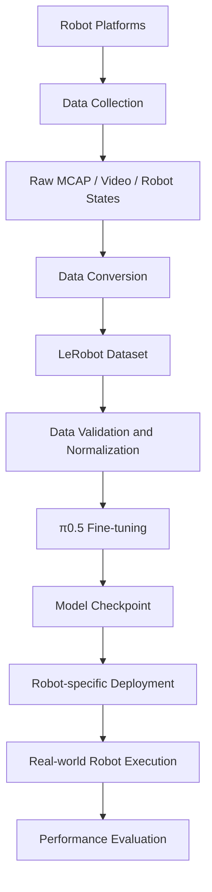

# Robot Data Collection and VLA Model Deployment

A modular robotics engineering framework covering robot teleoperation, multimodal data collection, dataset processing, π0.5 fine-tuning, and real-world deployment.

## 1. Project Overview

This project documents an end-to-end robotics data and model deployment pipeline across multiple robotic platforms, including:

- **Piper:** Dual-arm robotic data collection.
- **YAM:** Robotic data collection and π0.5 real-world deployment.
- **TOK2 (AIRBOT):** Dual-arm data collection and π0.5 real-world deployment.

The repositories are organized into three functional layers: data collection, data processing and model training, and real-world model deployment.

## 2. Repository Structure

### 2.1 Data Collection

| Repository                                                                                 | Platform | Description                                                                                                                           |
| ------------------------------------------------------------------------------------------ | -------- | ------------------------------------------------------------------------------------------------------------------------------------- |
| [piper-dual-arm-data-collection](https://github.com/Cqhddyb/piper-dual-arm-data-collection) | Piper    | Dual-arm robotic data collection, joint-state recording, multi-camera acquisition, timestamp management, and MCAP dataset generation. |
| [yam-data-collection](https://github.com/Cqhddyb/yam-data-collection)                       | YAM      | Robot state and camera data acquisition, leader-follower control integration, episode management, and MCAP recording.                 |
| [tok2-data-collection](https://github.com/Cqhddyb/tok2-data-collection)                     | TOK2     | Dual-arm AIRBOT data collection, robot state acquisition, camera integration, and MCAP recording.                                     |

### 2.2 Data Processing and Model Training

| Repository                                                                   | Description                                                                                                                               |
| ---------------------------------------------------------------------------- | ----------------------------------------------------------------------------------------------------------------------------------------- |
| [robot-data-pi05-toolkit](https://github.com/Cqhddyb/robot-data-pi05-toolkit) | Data conversion from raw MCAP/CSV recordings to LeRobot datasets, data validation, normalization statistics, and π0.5 fine-tuning tools. |

### 2.3 Real-world Model Deployment

| Repository                                                             | Platform | Description                                                                                                      |
| ---------------------------------------------------------------------- | -------- | ---------------------------------------------------------------------------------------------------------------- |
| [tok2-pi05-deployment](https://github.com/Cqhddyb/tok2-pi05-deployment) | TOK2     | Fine-tuned π0.5 policy inference, robot observation processing, action mapping, and real-world execution.       |
| [yam-pi0.5-deployment](https://github.com/Cqhddyb/yam-pi0.5-deployment) | YAM      | π0.5 model deployment, camera observation processing, robot control, task scheduling, and execution management. |

## 3. End-to-End Workflow

## 4. Technical Scope

The engineering work covers:

- Multi-platform robotic data collection.
- Multi-camera acquisition and timestamp synchronization.
- Robot state and action representation.
- MCAP data recording and parsing.
- LeRobot dataset construction and validation.
- π0.5 model fine-tuning and checkpoint management.
- Real-time policy inference and robot action execution.
- Runtime monitoring, exception handling, and safety mechanisms.

## 5. Design Principles

- **Modularity:** Each hardware platform and functional stage is maintained independently.
- **Reproducibility:** Preserve configuration files, dependencies, technical documentation, and validation scripts.
- **Traceability:** Maintain clear data provenance from raw recordings to trained checkpoints.
- **Hardware-aware deployment:** Separate robot-specific observation adapters, action mappings, and control interfaces.
- **Engineering reliability:** Include offline tests, data validation, exception handling, and deployment diagnostics.

## 6. Notes

Each repository contains its own detailed documentation, source code, installation instructions, and reproduction guide.

Please refer to the individual repositories for implementation details and platform-specific configurations.
